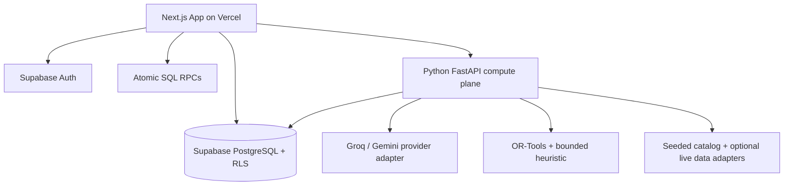

# 🧭 itinere — Personalized Multi-City Travel Planning

> **Official problem statement:** GlobeTrotter — Empowering Personalized Travel Planning  
> **Architecture:** Deterministic Core, Generative Edge  
> **Project goal:** A responsive, relational, collaborative travel planner with grounded AI and a resilient free-tier deployment strategy.

## Overview

**itinere** helps travelers create multi-city trips, search destinations and activities, schedule day-wise itineraries, visualize journeys on maps and calendars, track costs, and share or copy trips. Its AI features generate itinerary drafts, suggest optimizations, and answer questions about the user's current trip.

The central engineering principle is **Deterministic Core, Generative Edge**: PostgreSQL and application code own trip state, permissions, schedule validity, route constraints, and budget arithmetic. An LLM can interpret user intent and propose changes, but the system validates every generated ID and proposed change before the user approves an atomic database commit.

## Key Features

- Email/password signup, login, password recovery and profile settings.
- Dashboard, trip CRUD and personalized preferences.
- Multi-city itinerary builder with stop/activity reordering and locks for fixed commitments.
- City and activity search with filters, coordinates, provenance and real photos when a licensed/attributed match exists.
- Day-wise itinerary, calendar/timeline and map display.
- Canonical trip cost ledger, category/day breakdowns, and budget alerts.
- Revocable read-only public share links and Copy Trip.
- AI Travel Assistant, AI Itinerary Optimization and context-aware Trip Assistant.
- Optional group collaboration, weather-aware replanning, analytics and live data providers.

## Architecture at a Glance



- **Data plane:** Supabase Auth, PostgreSQL, PostgREST, RLS, Storage and RPC functions.
- **Compute plane:** FastAPI for AI, optimization, proposal validation and optional provider enrichment. Manual CRUD must remain usable if FastAPI is sleeping or unavailable.
- **Catalog:** stored records first; optional bounded POI/image/weather/routing providers cannot be required for core functionality.
- **AI safety:** preview → validate → approve → commit.

See [`systemarchitect.md`](./systemarchitect.md) for the complete system design, traceability matrix, relational model, API contracts, security rules, deployment plan, and testing checklist.

## Technology Stack

| Layer | Technology |
|---|---|
| Frontend | Next.js App Router, React, TypeScript, Tailwind CSS, shadcn/ui or existing UI library |
| Client data/forms | TanStack Query, React Hook Form, Zod, `@dnd-kit` |
| Maps/charts | MapLibre GL JS with a verified tile provider; Recharts |
| Database/Auth | Supabase PostgreSQL + Supabase Auth + RLS + Storage |
| Atomic operations | PostgreSQL RPC/transactions |
| Compute / optimization | Python FastAPI, Pydantic, Google OR-Tools; bounded 2-opt fallback |
| LLM | Configurable Groq and Gemini provider adapters; rule-based fallback; optional local Ollama for development |
| Place/image data | Curated seed catalogue; optional OSM/POI adapters; Wikimedia Commons metadata and attribution |
| CI/CD | GitHub Actions; feature branches and pull requests |

**Free-tier note:** all external providers have limits and their terms can change. Confirm the current quota and model availability in your accounts. Do not enable paid billing automatically. No provider is allowed to be a single point of failure for manual trip planning.

## Global Destination and Photo Strategy

1. Start with a reviewed seed target of 100+ cities and 1,500+ attractions, with stable IDs, coordinates, categories, and source metadata.
2. Search the local PostgreSQL catalog first.
3. If a place is missing, optionally use a bounded provider adapter and cache permitted results.
4. Match images through Wikimedia/provider metadata; record creator, licence, source page and attribution.
5. Use a placeholder where an attraction photo cannot be verified.
6. Keep live discovery, weather, route matrix, FX and embeddings optional. Never call public services on every keystroke or treat public OSM infrastructure as unlimited.

## Getting Started

The exact commands depend on the current team repository. Audit it before scaffolding or replacing files.

### Prerequisites

- Git and Node.js compatible with the repository's `package.json`.
- Python version compatible with `backend/` dependencies, once the FastAPI service is present.
- Access to the team's Supabase project and GitHub repository.
- Optional: Groq/Gemini provider keys after verifying current free-tier access.

### Local setup (intended layout)

```bash
# Clone the team repository and create a feature branch first.
git clone https://github.com/VedantVallal/GlobeTrotter.git
cd GlobeTrotter

# Inspect the existing project before running/installing anything.
git status
git branch -a
```

Use the package manager and scripts already defined in the repository. Do not assume `npm run dev`, migrations, or tests exist until the repository audit confirms them.

### Environment configuration

Create local environment files from `.env.example`. Frontend variables may include the Supabase URL, publishable/anon key and FastAPI base URL. Place Groq/Gemini keys and any private POI/routing API keys only in the backend's secret store. Never commit `.env` files or expose service-role credentials to browser code.

### Development order

1. Audit existing code and preserve functional work.
2. Implement database migrations, RLS, views and atomic RPCs.
3. Implement auth and manual trip CRUD.
4. Build the stored city/activity catalog and attributed photo metadata.
5. Implement Builder, itinerary view, calendar and canonical budget ledger.
6. Add map display and bounded deterministic route optimization.
7. Add grounded AI draft/optimize/chat and validation.
8. Add the disruption/Chaos Engine and collaboration.
9. Deploy and run end-to-end tests against the live site.

## Budget and AI Correctness

`budgets` stores the trip's limit and currency. `trip_cost_items` is the canonical ledger for estimate and actual rows. Catalog activity prices are defaults and must not also be summed directly. Dashboard and Budget screens should use the same database aggregate. Do not add amounts in different currencies without a known conversion snapshot.

AI-generated plans must reference actual catalog IDs, fit trip dates and valid schedule windows, respect locked activities and hard budget limits, and remain a draft until user approval. LLM failure must not block manual planning.

## Git Collaboration

- Work on a feature branch, not directly on the default branch.
- Commit after each stable implementation milestone.
- Review diffs and run available lint/tests/build checks.
- Open a pull request to the team leader's branch for review.
- If you lack write permission, ask for access or contribute from a fork; do not overwrite the team's project folder.

## Deployment & Test Checklist

- [ ] Migrations apply from a clean database.
- [ ] RLS tests deny cross-user access.
- [ ] Manual create/edit/reorder/delete works without AI.
- [ ] Catalog search works with external providers disabled.
- [ ] Photo attribution appears where required.
- [ ] Calendar and Builder stay synchronized after refresh.
- [ ] Dashboard and budget totals match canonical SQL aggregates.
- [ ] AI invalid IDs, quota failures and timeouts are handled safely.
- [ ] Proposal diffs require approval and enforce `trips.version`.
- [ ] Share links can be revoked and copied trips are private and independent.
- [ ] Live deployment passes end-to-end tests.
- [ ] No secrets appear in Git or frontend build output.
- [ ] Free quotas and provider terms are rechecked before judging.

## Reference Documentation

- [Supabase RLS](https://supabase.com/docs/guides/database/postgres/row-level-security)
- [Supabase Database Functions / RPC](https://supabase.com/docs/guides/database/functions)
- [Supabase PostGIS](https://supabase.com/docs/guides/database/extensions/postgis)
- [Supabase pgvector](https://supabase.com/docs/guides/database/extensions/pgvector)
- [Render Free Web Services](https://render.com/docs/free)
- [Vercel Python Functions](https://vercel.com/docs/functions/runtimes/python)
- [Groq rate limits](https://console.groq.com/docs/rate-limits)
- [Gemini API pricing](https://ai.google.dev/gemini-api/docs/pricing)
- [Gemini models](https://ai.google.dev/gemini-api/docs/models)
- [Google OR-Tools routing with time windows](https://developers.google.com/optimization/routing/vrptw)
- [Nominatim usage policy](https://operations.osmfoundation.org/policies/nominatim/)
- [Overpass usage guidance](https://dev.overpass-api.de/overpass-doc/en/preface/commons.html)
- [Wikimedia Commons reuse guidance](https://commons.wikimedia.org/wiki/Commons:Reusing_content_outside_Wikimedia)
- [OpenFreeMap](https://openfreemap.org/)

---

**Project status:** Architecture baseline finalized. Implementation readiness depends on the team repository audit, current provider account eligibility, and passing the acceptance tests described in `systemarchitect.md`.
