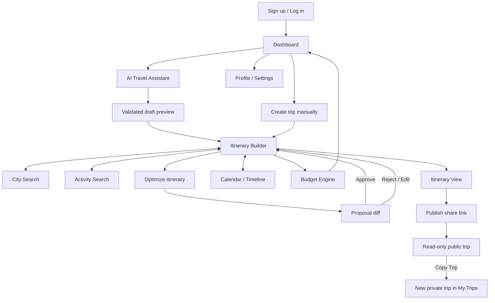
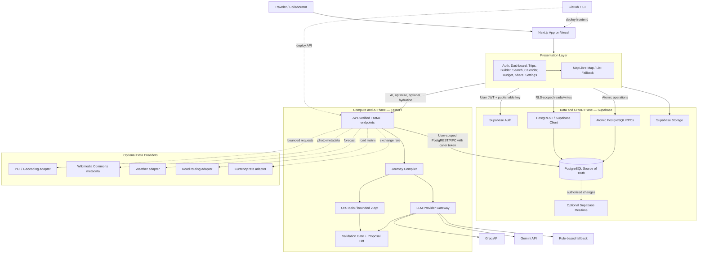
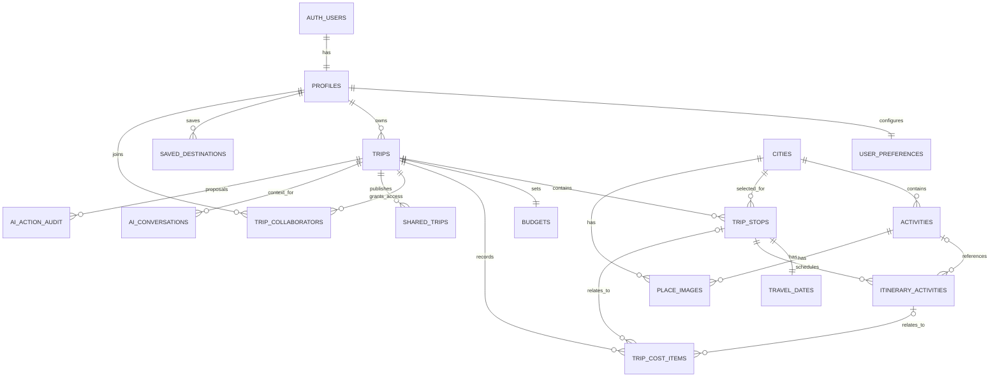
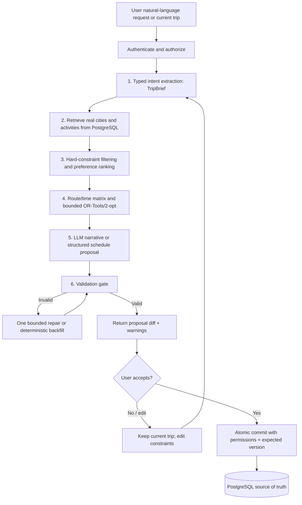

# itinere — Final System Architecture & Engineering Blueprint

> **Official problem statement:** GlobeTrotter — Empowering Personalized Travel Planning  
> **Project name:** itinere  
> **Architecture pattern:** Deterministic Core, Generative Edge (Neuro-Symbolic Planning)  
> **Document status:** Final architecture baseline for implementation  
> **Last reviewed:** 20 October 2026

---

## 0. Executive Decision

**Build itinere as a split-plane modular system:**

- **Data and CRUD plane:** Next.js App Router on Vercel, using Supabase Auth, PostgreSQL, Row-Level Security (RLS), PostgREST, and carefully designed PostgreSQL RPC functions for ordinary trip operations.
- **Compute and AI plane:** a small Python FastAPI service for AI generation, constrained itinerary optimization, disruption replanning, and optional live-data hydration. Render Free is the initial deployment target, but the service must be allowed to sleep; a cold start or outage must not break manual trip planning. A Vercel Python Function deployment is only an optional alternative after compatibility and runtime tests.
- **One source of truth:** Supabase PostgreSQL stores users' trips, stops, scheduled activities, costs, collaboration memberships, share permissions, and the persisted destination/activity catalog.
- **Grounded AI:** the LLM parses natural language and explains proposals. Deterministic application code and PostgreSQL enforce IDs, dates, costs, schedule constraints, permissions, and commits.
- **Stored-catalog first:** city and activity search works from seeded/cached PostgreSQL records. Live place discovery, weather, route services, currency conversion, and embedding APIs are optional adapters—not prerequisites for core functionality.
- **Review before write:** AI and optimization produce a proposal diff. The user reviews and accepts it. An atomic database operation checks permissions and the current trip version before committing.

The free-tier goal is **$0 for the hackathon deployment**, subject to current provider terms, quotas, account eligibility, and usage. No free plan guarantees uninterrupted service or unlimited requests. Do not enable paid billing or silently upgrade a provider to recover from quota exhaustion.

## 1. Alignment With the Official Problem Statement

The official brief requires a responsive multi-city trip planner with dates, activities, budgets, relational persistence, search, visual calendars, sharing, and three AI capabilities. The admin analytics screen is optional.

### 1.1 Official screen traceability

The visual workflow blueprint uses workflow identifiers `01`–`10`, `11A`–`11C`, `12`, `14`, and `15`. Those are workflow labels, **not** the official problem statement's screen numbering. The table below maps both and resolves the apparent numbering mismatch.

| Official requirement | Workflow label | Route | Main implementation/data contract | Priority |
|---|---|---|---|---|
| 1. Login / Signup | 01 | `/auth` | Supabase Auth; signup, login, logout, forgot-password, validation; `profiles`, `user_preferences` | P0 |
| 2. Dashboard / Home | 02 | `/dashboard` | Upcoming/recent trips, popular/recommended cities, quick actions, saved destinations, budget highlights | P0 |
| 3. Create Trip | 03 | `/trips/new` | Name, date range, description, budget/currency, optional cover upload; `trips`, `budgets`, Storage | P0 |
| 4. My Trips | 04 | `/trips` | List, status/date filters, destination count, view/edit/delete; owner/member-scoped trip queries | P0 |
| 5. Itinerary Builder | 05 | `/trips/[id]/builder` | Add/reorder stops, set dates, assign activities, schedule, lock fixed items; atomic RPCs | P0 |
| 6. Itinerary View | 08 | `/trips/[id]` | Day/city/activity view; map; List/Calendar toggle | P0 |
| 7. City Search | 06 | `/explore/cities` | Search, country/region, cost index, popularity, coordinates, Add to Trip | P0 |
| 8. Activity Search | 07 | `/explore/activities` | Type/interest/cost/duration/indoor filters, description, attributed image, add/remove | P0 |
| 9. Budget & Cost Breakdown | 10 | `/trips/[id]/budget` | Canonical cost ledger, category/day aggregations, charts, daily and total budget alerts | P0 |
| 10. Calendar / Timeline | 09 | `/trips/[id]/calendar` | Day-by-day timeline, expand/collapse, reschedule/reorder, overlap validation | P0 |
| 11. Shared/Public Itinerary | 14 | `/share/[token]` | Safe read-only public projection, revocable link, social preview, Copy Trip/fork | P0 |
| 12. Profile / Settings | 15 | `/settings` | Profile, language/currency/preferences, saved destinations, account deletion | P1 |
| 13. Admin / Analytics | ADMIN | `/admin` | Optional, role-gated platform aggregates; never rely on frontend hiding for security | P2 |
| AI Travel Assistant | 11A | `/trips/new?mode=ai` or assistant drawer | Parse natural-language brief, retrieve real catalog records, return draft to Builder | P1 / brief-required |
| AI Itinerary Optimization | 11B | Builder / itinerary view | Constraint solver + budget alternatives; return editable diff proposal | P1 / brief-required |
| Conversational Trip Assistant | 11C | Trip assistant drawer | Answers grounded in authorized current-trip context; proposes allowed actions | P1 / brief-required |
| AI Context / Retrieval | 12 | Backend service, not a standalone required screen | Scoped SQL retrieval; optional vector search; no cross-user context | Supporting module |

**Acceptance rule:** a feature is not complete just because its route exists. It must read/write the correct database records, enforce permissions, show loading/empty/error states, survive refresh, and be tested end-to-end.

### 1.2 User journey and off-page connectors



Connector definitions from the visual blueprint:

- **① AI draft → Builder:** AI produces a draft; the user reviews and edits it in the Builder before saving.
- **② Optimizer ↔ Builder:** Builder supplies the current trip; optimizer returns a proposal diff; the user accepts, edits, or rejects it.
- **③ Itinerary → Budget:** scheduled activities, travel legs, and canonical cost records feed budget aggregates.
- **④ Budget → Dashboard:** aggregate spend, daily average, and over-budget status are visible from the dashboard.
- **⑤ Public Trip → My Trips:** Copy Trip creates a separate private clone; it never edits the original trip.

### 1.3 Stored-data baseline versus live APIs

The workflow blueprint states that the core experience should work from a static city/activity dataset and does not assume live travel feeds. This architecture preserves that guarantee:

1. The shipped database seed is the primary data source.
2. City search, activity search, itinerary creation, budgeting, sharing, and RAG context continue to work with live external APIs disabled.
3. Just-in-time (JIT) discovery, weather, geocoding, map tiles, road routing, image refresh, FX, and embeddings are **optional adapters**.
4. If an optional adapter fails or reaches a quota, show a clear status and use cached/seeded records or manual custom-place entry.

No project can honestly guarantee zero deployment issues or permanent availability of third-party free services. The objective is to prevent an external service from taking down the essential itinerary workflow.

---

## 2. Guiding Engineering Principles

1. **Deterministic core, generative edge.** LLM outputs are proposals, not database truth.
2. **Single relational source of truth.** Builder, calendar, budget, dashboard, public trip view, and AI context use the same PostgreSQL records.
3. **Least privilege.** RLS protects user rows; privileged credentials never reach the browser; public shares return a safe projection only.
4. **No double-counting.** `trip_cost_items` is the canonical cost ledger; catalog price metadata is not automatically summed as an expense.
5. **Stored-catalog first.** Search and manual planning do not require live-provider success.
6. **Graceful degradation.** AI unavailable means manual planning still works; map tiles unavailable means list views still work.
7. **Preview → validate → approve → atomic commit.** Replanning never silently overwrites the current trip.
8. **Observable and reproducible.** Every schema change is a migration; every important integration has tests, timeouts, and safe error handling.
9. **Bounded compute.** Optimization considers a capped set of places and a strict solver time limit. It must return a valid heuristic result or a transparent failure, not hang.
10. **No unsupported real-time claims.** Weather, popularity, route durations, costs, and opening times carry provenance/freshness labels when applicable.

## 3. Final Technology Stack

| Layer | Decision | Why / boundary |
|---|---|---|
| Frontend | Next.js App Router + React + TypeScript; use the repository's tested compatible version | Responsive UI and server-rendered public share pages with social metadata |
| UI/styling | Tailwind CSS + shadcn/ui or the repository's existing accessible component system | Consistent visual system without implementing primitives repeatedly |
| Client state/data | TanStack Query; React Hook Form + Zod; `@dnd-kit` | Query caching, typed forms, predictable optimistic updates and drag-and-drop |
| Maps | MapLibre GL JS with an approved tile source such as OpenFreeMap; fallback map/list mode | Interactive vector map; verify the tile provider's current terms and attribution |
| Charts | Recharts | Budget breakdown and optional admin aggregates |
| Auth / relational DB | Supabase Auth + PostgreSQL + PostgREST + RLS | Integrated managed relational data and user authorization |
| Database functions | PostgreSQL RPC/transactions for atomic reorders, proposal commits, copy-trip and budget views | Protect invariants and avoid partial multi-row writes |
| Spatial support | Supabase PostGIS extension, enabled only if available/configured | Distance/radius queries; indexed geographic points |
| Search baseline | PostgreSQL full-text, `pg_trgm`, tags and indexed filters | Works without embedding inference or live data APIs |
| Optional semantic search | `pgvector` only after a consistent embedding model and runtime embedding path are confirmed | Do not make global search dependent on an unreliable free embedding quota |
| Compute / AI plane | Python FastAPI + Pydantic + Google OR-Tools | Clean typed API, planning validation and constrained optimization outside the database CPU path |
| Initial API hosting | Render Free Web Service, with cold-start-aware UX | Lowest-friction host for lightweight Python API; free services sleep and have quota limits |
| Optional compute alternative | Vercel Python Functions only after a separate deploy/test spike | Not assumed to be a drop-in backup; packaging, limits and OR-Tools compatibility must be tested |
| LLM gateway | Provider adapter: Groq first, Gemini second, deterministic template fallback; Ollama for local development | Current models/quota vary, so model IDs are configuration, not hard-coded assumptions |
| Global place/image data | Curated seed + optional OpenStreetMap/Overpass/Photon/OpenTripMap adapter + Wikimedia Commons metadata | Real places and photos with attribution/provenance; live discovery remains optional |
| Weather | Open-Meteo adapter, optional | Weather-aware suggestion; must not block normal use |
| Route matrix | Route-provider adapter; OSRM-compatible service for eligible road journeys only | Never use road durations as train/flight duration; public OSRM demo has no production SLA |
| FX | Frankfurter or another suitable free FX provider, optional and cached | Snapshot conversion rate/date; if unavailable, do not silently add unlike currencies |
| CI | GitHub Actions for lint, tests, type check, migration checks where configured, and build | Catch integration issues before merge |
| Error diagnostics | Structured logs and request IDs; optional Sentry free tier if acceptable | Never log secrets or unnecessarily retain sensitive prompts |
| Workflow automation | No n8n in the critical path | Direct typed API orchestration is simpler; add automation only for later independent jobs |

### 3.1 Free-tier rules

- Check current quotas, model availability, eligibility, privacy terms, and payment-card requirements in each account before depending on a service.
- Do not hard-code a specific Groq/Gemini model ID as permanent. Set `GROQ_MODEL` and `GEMINI_MODEL` after testing supported models in the respective dashboards.
- A prior model recommendation such as `llama-3.3-70b-versatile` or `gemini-2.5-flash` may not be available to every new project at the time of deployment.
- Do not run a local model on the hosted FastAPI service. Ollama is a development-only adapter unless a separately provisioned model host is deliberately chosen.
- Do not assume a five-minute UptimeRobot check guarantees Render uptime or is a permanent substitute for a paid always-on service. The app must tolerate cold starts.
- Do not use a public OSM/Overpass, tile or routing service as an unlimited, guaranteed production backend.
- Do not silently enable billing, switch to paid tiers, or retry model calls indefinitely.
- Gemini free-tier data-use terms differ from paid terms; send minimal trip context and never send secrets or unnecessary PII.

---

## 4. High-Level Split-Plane Architecture



### 4.1 Data plane

The frontend uses Supabase with the signed-in user's JWT for normal CRUD. RLS is the ultimate row-level permission boundary. Complex operations—reorder stops, apply optimizer diff, copy trip, update budget costs—use narrow PostgreSQL RPC functions with explicit authorization, input validation, expected trip version, and a transaction.

### 4.2 Compute plane

FastAPI handles work that is unsuitable for short database functions: LLM calls, candidate orchestration, route matrix retrieval, bounded optimization and optional live-data hydration. The service authenticates the Supabase access token and obtains trip data only within the caller's authorization. For user-owned operations it should call Supabase with the caller's token so RLS remains effective.

A server-only service-role key is not a shortcut for user CRUD. If a trusted seed/JIT ingestion job truly needs privileged catalog writes, isolate that operation, validate the provider response, restrict the writable tables/function, and keep the key only in server-side secrets.

### 4.3 Failure isolation

| Failure | Core trip CRUD | AI/optimization | Search/images/maps |
|---|---|---|---|
| FastAPI cold start/outage | Works through Supabase | Delayed/unavailable; retry/fallback | Seeded catalog search continues |
| LLM quota/provider outage | Works | Template/rule-based planning or clear AI-unavailable response | No effect on catalog |
| POI provider outage | Works | Uses existing catalog | Cached/seeded results; manual custom place |
| Image metadata unavailable | Works | No effect | Placeholder or cached licensed image |
| Weather provider outage | Works | Weather-aware optimization disabled; rest of plan works | Show weather unavailable |
| Route service outage | Works | Use stored/manual travel leg or labeled approximation; don't claim verified routing | Map still shows locations |
| Tile provider outage | Works | Works | List/timeline remains usable; map shows error/fallback |
| FX provider outage | Works | Budget stays in native currencies; no mixed-currency total presented as exact | Show rate unavailable/stale |

---

## 5. Core Feature Modules

1. **Auth/Profile Service:** Supabase Auth session, profile and preference management.
2. **Trip Service:** create/read/update/delete, lifecycle state, ownership and version control.
3. **Itinerary Service:** trip stops, travel dates, scheduled occurrences, ordering, time conflict validation, locked items.
4. **City Catalog Service:** city search/filter, popularity, region/country, cost index, coordinates and source provenance.
5. **Activity Catalog Service:** attraction search, tags, category, indoor/outdoor, estimated duration/cost and image attribution.
6. **Budget Service:** canonical cost ledger, estimates vs actuals, category/day aggregates, currency snapshot and budget alerts.
7. **Sharing Service:** public token validation, read-only trip projection, revoke/expiry, Copy Trip.
8. **Collaboration Service:** owner permissions and editor/viewer membership; optional Realtime after concurrency rules are tested.
9. **Journey Compiler:** natural-language parsing, candidate retrieval, deterministic scoring, scheduling, AI proposal and validation.
10. **Disruption/Chaos Engine:** local repair of only the affected itinerary subgraph while preserving locked/completed items.
11. **Analytics Service:** optional read-only aggregates with server-verified admin permissions.
12. **Provider Adapters:** POI, geocoding, image metadata, weather, route matrix, FX and LLM gateway.

Start as a modular monorepo. Do not split every module into microservices. Deploy only the frontend, the single FastAPI compute service, and Supabase managed components.

---

## 6. Relational Data Model

### 6.1 Source-of-truth relationships



`auth.users` is managed by Supabase. The application-facing **Users** entity is represented by `profiles` linked one-to-one to `auth.users`; never create a second independent password store.

### 6.2 Tables and key fields

| Table | Core fields / rules | Purpose |
|---|---|---|
| `profiles` | `id` FK to `auth.users.id`, display name, avatar URL, role, created/updated timestamps | Application user profile |
| `user_preferences` | user ID PK/FK, interests/tags, pace, language, preferred currency, crowd preference, privacy preferences | Profile personalization |
| `trips` | UUID, `owner_id`, name/title, description, start/end dates, status, base currency, `version`, optional cover URL, copied-from trip ID | Main trip record; `end_date >= start_date` |
| `cities` | UUID, name, country/country code, region, timezone, coordinates, cost index, popularity score, source provider/record ID, source URL, fetched/verified timestamps | Global city catalogue |
| `activities` | UUID, city ID, name, category/tags, coordinates, duration, optional cost estimate + currency, indoor/outdoor, description, source/provider ID, source URL, verified timestamp | Reusable place/POI/activity catalog, not a scheduled occurrence |
| `place_images` | city or activity FK (exactly one target), original/thumbnail URL, source page, creator, licence label/URL, attribution text, verification time and match confidence | Properly attributed real images |
| `trip_stops` | UUID, trip ID, city ID, position, locked flag, notes | Ordered city stops in one trip |
| `travel_dates` | one row per stop, arrival/departure date, local timezone snapshot, travel-mode notes | Dates for that city stop; ranges must fit trip boundaries |
| `trip_legs` | trip ID, from/to stop IDs, mode, optional distance/duration, estimate flag, source, `is_locked` | Inter-city transit; modes can be flight/train/bus/car/ferry/other |
| `itinerary_activities` | stop ID, optional catalog activity ID, custom title, scheduled local date, start/end time or timestamp, position, timezone interpretation, locked flag, notes, optional assigned member IDs | Particular scheduled occurrence; constraints apply to the occurrence, not catalog record |
| `budgets` | unique trip ID, budget limit, currency, optional daily target, alert preference | One budget definition per trip |
| `trip_cost_items` | trip ID, optional stop/activity/leg FK, category, `kind` (`estimate`/`actual`), amount, ISO currency, optional normalized amount/rate/date/source, incurred date, description | **Canonical cost ledger**; logical replacement for the workflow's Expenses records |
| `saved_destinations` | user ID + city ID unique, saved timestamp | Bookmarks |
| `trip_collaborators` | trip ID + user ID unique, role `editor` or `viewer`, joined timestamp | Non-owner sharing; owner is defined by `trips.owner_id` |
| `shared_trips` | trip ID, hash of random share token, allow-copy flag, expiry/revocation timestamps, creation time | Revocable read-only public link; multiple links per trip allowed |
| `ai_conversations` | trip ID, user ID, role, message content (with retention policy), timestamp | Minimal context history where needed; never logs secrets |
| `ai_action_audit` | trip ID, user ID, proposal ID, trip version, structured diff, status (`proposed/approved/rejected/expired/failed`), timestamps | Auditable proposal lifecycle; stores only necessary data |
| `provider_cache` (optional) | provider, normalized query/key, response JSON, fetched/expiry timestamps, status | Cached JIT responses according to source policies |

### 6.3 Constraints and integrity rules

- Enable PostgreSQL extensions only when needed and available in the selected Supabase project. PostGIS and pgvector are optional capabilities; neither must block the base project.
- Use `NUMERIC` for amounts, never binary floating-point money calculations.
- Use ISO 4217 currency codes (`INR`, `USD`, etc.). Do not sum unlike currencies without a conversion rate snapshot.
- `trip_stops.position` is unique within a trip; `itinerary_activities.position` is unique within a stop/day as appropriate.
- `travel_dates` row is unique per stop. Validate stop dates against the parent trip in a controlled transaction/RPC because a simple row-level `CHECK` cannot validate a value in another table.
- Activity end must be after activity start. Validate schedule overlaps and travel buffers in application/RPC logic, with database constraints where suitable.
- Every FK and related child operation must pass RLS authorization. RLS is required on all exposed user data tables.
- `activities.estimated_cost` is a catalog default only. Budget aggregations never sum catalog prices directly.
- Adding an activity to an itinerary may create an associated `trip_cost_items` estimate snapshot. Editing/removing that ledger row updates budget totals consistently.
- Actual spending uses `kind='actual'`; estimated plan costs use `kind='estimate'`. Do not add estimates and actuals together as one total unless the chart explicitly labels them separately.
- Deleting a trip cascades through its child trip records, costs, conversations and shares according to documented retention. Deleting a catalog city referenced by trips should be restricted or use an explicit archival policy.
- Reorder, copy-trip and apply-diff operations run transactionally. Use two-phase re-numbering or a safe temporary position strategy to avoid unique-position collisions.
- Update `trips.version` on every accepted structural edit. RPCs accept `expected_version`; a mismatch returns a conflict instead of overwriting collaborator changes silently.

### 6.4 Canonical budget view

Both Budget screen and Dashboard read the same SQL aggregation contract, conceptually named `v_trip_budget_breakdown` and `v_trip_daily_budget`.

- `budgets` supplies the budget limit/currency.
- `trip_cost_items` supplies planned cost rows and actual spending rows.
- The view groups by category, day/date, and `kind`, after converting to the trip's base currency only when a valid rate snapshot exists.
- The view returns a conversion-status field. If a cost cannot be converted, the UI must show the amount in its native currency and report an incomplete converted total rather than presenting a false precise total.
- All dashboard/budget charts use the view or a shared RPC; do not recalculate totals independently in React.

### 6.5 RLS and permissions

| Actor | Read | Write |
|---|---|---|
| Unauthenticated visitor | Safe public projection for valid share token; public catalog rows allowed by policy | None to user/trip tables |
| Owner | Own trip and permitted children | Full control over own trip, memberships and share links |
| Editor collaborator | Trip records explicitly shared with them | Trip itinerary/cost updates allowed by defined role policy; no ownership transfer or share administration unless separately authorized |
| Viewer collaborator | Shared trip projection and permitted details | No itinerary/cost modification |
| Catalog ingestion function | Only the validated catalog-write capability | No general permission to read/write private trips |
| Admin analytics | Authorized aggregate metrics and limited user-management metadata where required | Prefer read-only analytics; no ability to edit user itineraries through admin dashboards |

Supabase RLS documentation notes that enabling a policy alone does not remove existing grants; review grants and policies together. See [Supabase Row Level Security](https://supabase.com/docs/guides/database/postgres/row-level-security).

### 6.6 Public share design

- Generate at least 256 bits of cryptographically secure random token material.
- Place only the token in the public URL; store only its SHA-256 hash server/database-side. Hash the incoming token before lookup.
- Check `revoked_at IS NULL` and `expires_at` before returning data.
- Return a purpose-built public projection with share settings; do not expose emails, auth IDs, collaborator lists, private notes, conversation history, or private cost details unless the owner deliberately included them in the share projection.
- `Copy Trip` must clone trip, stops, travel dates, legs, itinerary occurrences, budget configuration and relevant cost estimates in one transaction, assigning the current user as new owner. Never copy actual personal expenses or collaboration/share tokens by default.

---

## 7. Global Destination, Activity and Image Strategy

### 7.1 The actual problem

The world contains far more destinations and points of interest than should be downloaded into a hackathon database. A system that queries several public APIs on each search will be slow, rate-limited and fragile. A system that relies only on 20 hardcoded city records will fail when a judge searches elsewhere.

The solution is a **three-layer stored-catalog-first discovery pipeline** with an optional fourth layer for embeddings.

### 7.2 Layer 1 — Curated seed catalogue

Initial target (not a claim that these records already exist):

- 100+ important global and Indian hub cities distributed across countries/regions.
- 1,500+ curated attractions or activities as a realistic seed target.
- A mix of landmark, culture/history, nature, food, family, relaxation and indoor categories.
- Real coordinates and source provenance for each record; realistic cost ranges only when a source or documented estimate is available.
- Image metadata with author, licence, source page and attribution for images that have been matched and reviewed.

Build this using a versioned ingestion script and curated seed files. The final record count depends on source quality, permitted acquisition, and review; do not label every automatically imported record as “verified” unless it passed the documented checks.

### 7.3 Layer 2 — Fame/popularity scoring

Use one or more available signals:

1. Editorial curated popularity score for known landmarks.
2. Wikimedia Pageviews for a confidently mapped Wikipedia article where available.
3. Provider popularity fields, when their meaning is documented.
4. Optional user saves/usage aggregates after the app has real usage.

A Pageviews-derived score is a **popularity proxy**, not an objective tourism ranking. It cannot rank places without a reliably mapped article and should not be fabricated for all POIs. Store the source and scoring timestamp.

### 7.4 Layer 3 — Optional just-in-time hydration

When a search misses the local catalog:

1. Search the local DB using normalized name, country code, trigrams and coordinates if provided.
2. If live discovery is enabled, call one permitted provider adapter using a bounded query and short timeout.
3. Normalize/deduplicate results by provider + external ID and required fields.
4. Enrich image metadata with a Wikimedia Commons match when a confident match exists.
5. Persist only records whose reuse terms permit storage and whose source/provenance is recorded.
6. Return the result with source/freshness labels. If anything fails, show cached data and “Add custom place.”

Potential adapters:

- **Photon:** geocoding/name suggestions; not an authoritative attraction/price source.
- **Overpass/OSM:** appropriately scoped feature/place lookup; public instances can shed load. Use conservative limits, caching, identifying User-Agent where required, attribution and an adapter so the provider is replaceable.
- **OpenTripMap:** optional POI provider only after current API access, quotas and terms are confirmed.
- **Wikipedia REST / Wikidata:** descriptive article/entity metadata and stable cross-reference candidates; not a guarantee of live business hours or exact prices.
- **Wikimedia Commons:** image metadata and reusable file information; each image may have distinct licence and attribution requirements.

The public Nominatim service is not a generic high-volume autocomplete service. Its policy sets a maximum of one request per second, requires identification/attribution and caching, and places restrictions on regular bulk requests. Avoid calling it for every keystroke; preferably use local results and a deliberately selected provider only when needed. See [Nominatim Usage Policy](https://operations.osmfoundation.org/policies/nominatim/). Public Overpass instances are shared infrastructure; see [Overpass API usage guidance](https://dev.overpass-api.de/overpass-doc/en/preface/commons.html).

### 7.5 Real image matching and licensing

For each image, store:

- `image_url` / `thumbnail_url`;
- original Commons or provider file page URL;
- creator/author;
- licence name and licence URL;
- required attribution string;
- provider and retrieval time;
- match method and confidence (e.g., Wikidata QID, exact article mapping, manual review).

Match by Wikidata ID where possible; otherwise require a strong name/location match. Do not use a generic city photo and label it as a particular attraction. If a match cannot be confirmed, use a clearly neutral placeholder. Do not rehost/download image files unless their licence and provider terms permit it. Attribution must remain visible wherever the photo is displayed. See [Wikimedia Commons reuse guidance](https://commons.wikimedia.org/wiki/Commons:Reusing_content_outside_Wikimedia).

### 7.6 Search and data freshness

- Core search: local PostgreSQL first; use indexes for city names, country/region, category, tags, provider IDs and normalized text.
- Optional `pg_trgm` fuzzy name matching helps misspellings without model inference.
- Optional vector search uses one documented embedding model/version and the same dimensions for both stored records and query embeddings. If query embeddings are unavailable, fall back to tags and full-text; vector search is not a mandatory dependency.
- Cache external results in PostgreSQL with source, fetched-at and expiry fields. Respect source terms; cache does not mean unrestricted redistribution is allowed.
- Provider failures return a useful empty/cached state, not a 500 that destroys the entire page.

### 7.7 Cost and opening-hours honesty

- Catalogue costs are estimates, not quotes. Store the source and confidence/status (`official`, `estimated`, `unknown`).
- No booking, inventory, transport schedule or business-hours API is assumed by the baseline architecture.
- If opening hours are not available and verified, the interface must say so. Do not present LLM-generated hours as fact.
- Train and flight journeys require a legitimate schedule source or explicit user input. OSRM road travel time must never be used as a train or flight duration.

---

## 8. The Journey Compiler: Neuro-Symbolic AI Pipeline

### 8.1 Pipeline overview



The six stages are a logical pipeline; not every request must call an LLM. Simple deterministic operations should not incur model latency or quota use.

### 8.2 Stage 1 — Typed intent extraction

Convert natural language into a validated `TripBrief`, for example:

```json
{
  "origin": "Solapur, India",
  "start_date": "2026-11-14",
  "end_date": "2026-11-16",
  "traveler_count": 2,
  "budget": {"amount": 8000, "currency": "INR", "hard_limit": true},
  "interests": ["nature", "local_food"],
  "pace": "relaxed",
  "avoid_crowds": true,
  "minimize_travel": true
}
```

This is an example schema, not a factual recommendation. Validate numeric ranges, date relationships, enumerations, currency codes, traveler count and missing information with Pydantic before retrieval. Ask for clarification only when a required value cannot reasonably be inferred; defaults must be explicit in the UI.

### 8.3 Stage 2 — Grounded retrieval / RAG

- Read the current authorized trip and profile preferences when applicable.
- Retrieve real city/activity rows with stable database IDs, coordinates, duration, price metadata and image/source provenance.
- Apply hard filters (trip dates, max budget, distance, activity duration, locked commitments) before ranking.
- Baseline retrieval uses SQL tags, full text and `pg_trgm`.
- Optional PostGIS adds geographic radius/nearby queries. Optional `pgvector` adds semantic similarity only when query and catalog embeddings come from the same tested model.
- Return a bounded set of candidates to the LLM; never pass the entire world catalog or other users' data.

### 8.4 Stage 3 — Deterministic route/time solver

Use Google OR-Tools for a bounded constrained routing/scheduling problem, with a simple nearest-neighbour + 2-opt fallback. OR-Tools supports routing with time windows, but a successful solver result depends on correctly supplied travel matrices and constraints; it does not magically provide real-world transport schedules.

Rules:

- Respect `is_locked` trip stops/legs/activities and fixed bookings.
- Do not reorder completed activities or commitments that the user locked.
- Within-city driving/walking travel estimates may come from a configured road routing adapter.
- Inter-city rail/air/bus time needs a separate source or user-entered estimate. Do not infer it from road distances.
- If only coordinates are available, use Haversine distance as a **straight-line heuristic**, clearly labelled as approximate—not road time.
- Bound the problem size (e.g. a capped set of candidate places per day) and set a strict solver time limit (initial target 1–3 seconds for the small hackathon workload). Always provide a deterministic fallback or an explicit “could not optimize within constraints” response.
- Do not claim a globally optimal result if using a heuristic or a limited matrix.

### 8.5 Stage 4 — LLM narrative and scheduling proposal

The LLM receives only the selected verified candidates, user's validated preferences and relevant constraints. It can propose a sequence and explain trade-offs, but it cannot create canonical place IDs, quote guaranteed prices, decide permissions, execute SQL, or call arbitrary URLs/tools.

Use a provider adapter with a JSON-schema-constrained output when supported. Validate every returned `city_id`, `activity_id`, time, cost reference and action against database rows and application rules.

### 8.6 Stage 5 — Validation gate

Reject or repair once, under a strict bound, if any validation fails:

- IDs must exist and be available to the request's user/context.
- Dates are within trip and stop boundaries.
- Start/end times are valid and activity durations are coherent.
- Invalid overlaps are rejected; travel buffers are included where a travel matrix exists.
- Locked/completed items remain unchanged.
- Cost rows reconcile in one currency or clearly report conversion gaps.
- Total estimate respects a hard budget; if impossible, return “infeasible” with alternatives rather than mislabelling it feasible.
- Proposal diff references current trip version and is schema-valid.

If a model output is invalid, the system may backfill from the already retrieved candidate set using deterministic rules. It must never fabricate a replacement POI or a price to make the JSON look complete.

### 8.7 Stage 6 — Preview → approve → atomic commit

- Store a minimal `ai_action_audit` proposal record with status `proposed` and the original `trip.version`.
- Send the client a diff: additions, removals, changes, estimated time/cost impact, warnings, and provenance.
- On acceptance, call a narrow RPC with the proposal, authenticated actor, idempotency key, and expected trip version.
- The RPC checks permissions and version, validates allowed fields, applies related updates in a transaction, updates cost ledger rows consistently, increments `trips.version`, and marks the proposal approved.
- On stale version, return a conflict and ask the UI to refresh/review. Rejected/expired proposals do not change the trip.

### 8.8 LLM provider gateway

```text
LLMProvider
  ├── generate_structured_trip_brief(input)
  ├── produce_grounded_proposal(input, candidates, trip_context)
  └── explain_diff(validated_diff, user_preferences)

Provider order (configurable):
  1. Groq API — model selected from current account-supported model list
  2. Gemini API — model selected from current account-supported/free-tier options
  3. Deterministic template/rule-based planner
  4. Optional local Ollama provider for development only
```

Set `GROQ_MODEL` and `GEMINI_MODEL` as configuration. Do not assume one model identifier remains available or that every new account receives the same free-tier quota. Read the current provider model and rate-limit documentation before final deployment.

Use a configurable timeout (initial target 8 seconds per hosted LLM request), bounded retries, exponential backoff only for retryable errors, output-token caps, and per-user rate limits. A 429 should respect provider retry hints or immediately fall back; never create an infinite retry loop. Avoid sending unnecessary PII to external LLM providers.

### 8.9 Conversational trip assistant: safe tools

The assistant can propose allowlisted operations such as:

- `suggest_activity_for_day`
- `propose_reschedule_activity`
- `propose_indoor_alternative`
- `propose_budget_rebalance`
- `summarize_trip_budget`

Tool invocation returns a proposed diff. It does not execute arbitrary SQL or directly mutate user data. Every action passes the same authorization, schema, schedule and budget checks as the itinerary builder.

---

## 9. Stateful DAG “Chaos Engine”

The Chaos Engine is a bounded **localized replanner**, not an always-running autonomous agent.

### 9.1 Model

- Nodes: scheduled activities and fixed travel legs.
- Edges: chronological order, travel-before-visit, locked booking requirements and other dependencies.
- Node states: planned, locked, completed, disrupted, replaced.
- Hard constraints: completed/locked nodes cannot be moved; a replacement must be within valid timing and any hard budget constraints.

The MVP may derive this graph from the stored itinerary instead of maintaining a separate persistent graph database.

### 9.2 Trigger and behavior

Triggers can be a user request, a weather response from an optional provider, or a simulated disruption in the demo. Live train/flight delays are **not assumed** unless a legitimate transport-status source is integrated.

Example rain flow:

1. Determine the affected time window and outdoor activities.
2. Preserve locked/completed nodes.
3. Search the stored catalog for nearby indoor replacements with compatible tags, remaining duration and cost.
4. Recalculate travel gaps and daily cost using available, appropriately labelled travel data.
5. Return a proposal diff with preserved items, replacements, costs and warnings.
6. Commit only after user approval and trip-version check.

The application must not promise a sub-800 ms live result or guaranteed weather prediction. Runtime depends on provider availability and candidate count; use bounded search and report estimates honestly.

---

## 10. Canonical Cost and Currency Model

This is a critical source of bugs in travel products. `budgets` expresses the user's limit. `trip_cost_items` is the only ledger that contributes to calculated costs.

### 10.1 Entry rules

- Every cost has amount, currency, category, kind (`estimate` or `actual`), date, and optional association to stop/itinerary activity/trip leg.
- Catalog `activities.estimated_cost` is a default estimate only; it is not summed in charts unless a ledger entry is deliberately created when that activity is scheduled.
- If scheduled activity cost changes, update its associated estimate ledger row through one controlled operation. Do not keep two independent sources of actual monetary truth.
- Manual transportation, accommodation, meals, and miscellaneous costs are ledger rows too.
- An actual expense linked to a planned estimate replaces that estimate in a “current spending” total according to documented display logic; charts may show planned vs actual separately.
- Store the original amount/currency and the FX rate/source/as-of date when a conversion snapshot is used. Rate changes must not silently rewrite historical actuals.
- If conversion is unavailable, label the total incomplete or show a native-currency breakdown; never silently sum INR + USD as if identical.

### 10.2 Metrics

The database view/RPC should calculate:

- Planned estimate total by trip and category.
- Actual spend by trip and category.
- Planned and actual daily totals.
- Average planned cost per trip day (`planned_total / inclusive_trip_days`).
- Remaining budget (`budget_limit - planned_total` or actual spend, with the selected metric labelled).
- Over-budget flag at trip and day level.
- Missing FX conversion count/status.

Both Dashboard and Budget pages must use the same view/RPC contract so their numbers match. Recharts renders the result; it does not perform the authoritative financial computation.

---

## 11. Collaboration, Concurrency and Trip Forking

### 11.1 Permissions

The owner is `trips.owner_id`. Non-owner members have `editor` or `viewer` roles. The owner can invite/remove collaborators and manage shares. Editors can modify only the permitted trip structure. Viewers are read-only. Exact role policy should be encoded in RLS and mutation RPCs.

### 11.2 Optimistic concurrency

Each trip has a monotonically increasing `version`.

- Clients pass `expected_version` on structural mutations.
- RPC checks the version and authorization in the same transaction.
- Accepted mutation increments version and returns the new version.
- If the version differs, return a conflict; refresh the state and ask the user to reconcile rather than overwrite silently.
- Use idempotency keys for operations that may be retried after network timeouts.

### 11.3 Supabase Realtime

Realtime co-editing is optional after RLS and optimistic concurrency tests pass. Realtime is a notification mechanism, not a substitute for authorization, locking or transaction safety. Subscribe only to records the member can access, and refresh/reconcile from PostgreSQL after notifications.

### 11.4 Split & Converge group planning

This is a stretch differentiator, not a core dependency. A group can store preference tags and evaluate activities using each member's utility score. Where interests diverge, the planner can suggest compatible parallel activities within an area/time window followed by a shared meetup. It should present trade-offs and require approval; no separate autonomous “agent per person” is needed for the MVP.

---

## 12. API and Integration Contracts

### 12.1 Request paths

**Normal CRUD** uses Supabase PostgREST with the signed-in user token and RLS. **Atomic mutations** use narrowly scoped PostgreSQL RPCs. FastAPI exposes compute/enrichment endpoints under `/api/v1`.

| Method / endpoint | Purpose | Data/guard |
|---|---|---|
| `GET /api/v1/health` | Readiness check for FastAPI | No secrets or dependency internals returned |
| `POST /api/v1/ai/plan-trip` | Build itinerary draft | Auth required, validated TripBrief, catalog retrieval, no automatic commit |
| `POST /api/v1/ai/optimize/{trip_id}` | Optimize existing trip | Authorized trip context, `expected_version`, return proposal diff |
| `POST /api/v1/ai/chat/{trip_id}` | Contextual assistant | User-scoped RAG, rate limit, allowlisted proposal tools only |
| `GET /api/v1/discovery/cities` | Catalog-first city search/hydration | Query limits; live adapters optional |
| `GET /api/v1/discovery/activities` | Catalog-first POI/activity search | City/coordinates/category filters; optional JIT adapter |
| `POST /api/v1/route-matrix` | Optional road travel matrix | Strict waypoint count, provider timeout and cache; road modes only |
| `POST /api/v1/weather` | Optional weather enrichment | Coordinates/date validation, short timeout/cache |
| `POST /api/v1/shares` or SQL RPC | Create share token | Owner permission; only hashed token persisted |
| `GET /share/[token]` | Public share page | Hash token, check expiry/revocation, return safe projection |
| SQL RPC `reorder_trip_stops` | Atomic stop reorder | Permission + expected trip version + transaction |
| SQL RPC `apply_itinerary_proposal` | Commit accepted diff | Permission, proposal status/version, constraints and transaction |
| SQL RPC `fork_trip` | Copy a shared trip | Valid active share token; new authenticated owner; transaction |
| SQL view/RPC `v_trip_budget_breakdown` | Common budget calculation contract | Scoped rows, estimate/actual separation, currency status |

Responses use a consistent shape, for example `{ "request_id": "...", "data": ..., "warnings": [] }` on success and `{ "request_id": "...", "error": { "code": "...", "message": "..." } }` on failure. Do not return stack traces, secret values or SQL text.

Recommended error codes include `VALIDATION_ERROR`, `UNAUTHENTICATED`, `FORBIDDEN`, `NOT_FOUND`, `VERSION_CONFLICT`, `BUDGET_INFEASIBLE`, `AI_RATE_LIMITED`, `AI_UNAVAILABLE`, `ROUTING_UNAVAILABLE`, `PROVIDER_RATE_LIMITED`, and `INTERNAL_ERROR`.

### 12.2 Authentication between frontend, FastAPI and Supabase

- Frontend signs in through Supabase Auth and passes the access token to FastAPI for AI/compute calls.
- FastAPI validates the token using the documented Supabase JWT/JWKS verification approach and derives the authenticated user ID from the verified claims. Never trust a raw `user_id` supplied by the request body.
- For user-scoped reads/writes, use the caller's token with PostgREST/RPC so RLS applies. Do not use the service-role key for routine user CRUD.
- The Supabase publishable/anon key is public configuration, not a secret; RLS is still mandatory.
- Service-role key, Groq/Gemini keys and optional provider keys stay server-side only.
- CORS must allow only known frontend origins in production; auth callback/redirect URLs must include the configured deployed domain and local development URLs.

### 12.3 Retry, idempotency and timeouts

- Validate every request with Pydantic or the existing equivalent schema before provider calls.
- Set finite connection/read timeouts for external calls; initial targets: short 3–5 second network provider timeout and configurable ~8 second LLM timeout. Tune with real deployment measurements.
- Retry only transient/idempotent calls and only a bounded number of times.
- Honor provider `Retry-After` guidance where available.
- Use a database idempotency record or command key for potentially retried writes; do not assume the browser sends a request only once.
- Limit route matrix sizes and candidate counts.
- Debounce UI search and use catalog queries before external enrichment.

---

## 13. Repository Structure

Keep a single Git repository unless the existing team repository has already established a different structure. Do not overwrite working files as part of a generated scaffold.

```text
itinere/
├── frontend/                         # Next.js App Router application
│   ├── src/app/
│   │   ├── auth/
│   │   ├── dashboard/
│   │   ├── trips/new/
│   │   ├── trips/page.tsx
│   │   ├── trips/[id]/page.tsx
│   │   ├── trips/[id]/builder/
│   │   ├── trips/[id]/calendar/
│   │   ├── trips/[id]/budget/
│   │   ├── explore/cities/
│   │   ├── explore/activities/
│   │   ├── share/[token]/
│   │   ├── settings/
│   │   └── admin/                    # optional
│   ├── src/components/               # map, itinerary cards, proposal diff, budget charts
│   ├── src/features/                 # auth, trips, search, budget, sharing, AI
│   └── src/lib/                      # Supabase client, schemas, API client
├── backend/                          # Python FastAPI compute plane
│   ├── app/main.py
│   ├── app/api/                      # health, plan, optimize, chat, optional providers
│   ├── app/core/                     # settings, JWT verification, rate limits, logging
│   ├── app/schemas/                  # TripBrief, itinerary draft, proposal diff
│   ├── app/services/
│   │   ├── llm_gateway.py
│   │   ├── catalog_retrieval.py
│   │   ├── route_matrix.py
│   │   ├── optimizer.py
│   │   ├── chaos_engine.py
│   │   ├── validation.py
│   │   └── provider_adapters/
│   ├── tests/
│   ├── requirements.txt or pyproject.toml
│   └── Dockerfile                    # for Render, if required
├── supabase/
│   ├── migrations/                   # versioned schema, RLS, views and RPCs
│   ├── seed/                          # curated catalog manifests/seed data
│   └── tests/                         # db/RLS tests
├── scripts/
│   ├── seed_global_catalog.py         # bounded, reproducible import/enrichment
│   ├── validate_catalog.py
│   └── verify_image_attribution.py
├── tests/e2e/                         # cross-feature Playwright tests
├── .github/workflows/ci.yml
├── .env.example
├── .gitignore
├── SYSTEM_ARCHITECTURE.md             # this document may be kept at this name too
└── README.md
```

If the current team repository is already using `src/` at the root rather than `frontend/`, keep that arrangement. Architecture should fit the repository, not force a destructive refactor solely to match this example tree.

---

## 14. Environment Configuration

Use `.env.example` with placeholders only. Actual secret files must be ignored by Git.

### Frontend `.env.local`

```dotenv
NEXT_PUBLIC_SUPABASE_URL=https://YOUR_PROJECT.supabase.co
NEXT_PUBLIC_SUPABASE_PUBLISHABLE_KEY=YOUR_PUBLIC_KEY
NEXT_PUBLIC_API_BASE_URL=https://YOUR-FASTAPI-SERVICE.example
```

Use the exact names expected by the installed Supabase SDK; `NEXT_PUBLIC_SUPABASE_ANON_KEY` may exist in an older codebase. A publishable/anon key is public configuration, but private data safety still depends on RLS.

### FastAPI server secrets/configuration

```dotenv
SUPABASE_URL=https://YOUR_PROJECT.supabase.co
SUPABASE_PUBLISHABLE_KEY=YOUR_PUBLIC_KEY
GROQ_API_KEY=
GROQ_MODEL=
GEMINI_API_KEY=
GEMINI_MODEL=
POI_PROVIDER=
POI_PROVIDER_API_KEY=
ROUTING_PROVIDER=
ROUTING_API_KEY=
WEATHER_PROVIDER=open-meteo
APP_ENV=production
CORS_ORIGINS=https://YOUR_FRONTEND_DOMAIN
AI_REQUESTS_PER_USER_PER_HOUR=10
LLM_TIMEOUT_SECONDS=8
```

For user-scoped Supabase calls the API uses the verified caller JWT. If a narrow backend-only seed/catalog ingestion operation needs an elevated key, add a separate server-only secret only after designing and testing the privilege boundary. Never expose it to the frontend or logs.

---

## 15. Deployment Plan

### 15.1 GitHub and development workflow

1. Clone the team repository and create a feature branch.
2. Inspect and run the existing app before making architectural changes.
3. Keep `systemarchitect.md` / `SYSTEM_ARCHITECTURE.md` and `README.md` aligned with the real stack.
4. Make versioned Supabase migrations; do not rely on undocumented dashboard-only schema changes.
5. Commit each working milestone; open a pull request for team-leader review.
6. CI checks lint, typecheck, tests, database policy tests where configured, and production build.

### 15.2 Supabase setup

1. Create or use the team's Supabase project.
2. Enable supported extensions deliberately (`postgis`, `vector`, `pg_trgm`, and any required crypto function) only when needed; follow current Supabase extension guidance and use the appropriate extension schema.
3. Apply migrations in order and run RLS/security tests.
4. Create storage buckets for optional trip-cover/profile images with explicit file type/size limits and user-folder policies.
5. Load the curated seed dataset and validate image/source attribution.
6. Configure Auth site URL, redirect URLs and email behavior. Test password recovery using a real test address; do not assume the default email configuration is production-grade.
7. Export/backup schema and seed files in Git. Confirm a recovery process before demo day.

### 15.3 FastAPI on Render Free

1. Deploy only the small Python compute service, not the database or local model weights.
2. Configure the service build/start commands from the tested repository files.
3. Add server-only provider secrets in the hosting dashboard.
4. Expose `/api/v1/health`, returning minimal status without secrets.
5. Set strict request and solver limits. Never rely on local filesystem persistence.
6. Expect idle cold starts and possible monthly free-instance-hour exhaustion. A monitoring ping can help detect or reduce idle spin-down for a demo, but it is not an uptime guarantee and must not be the sole availability strategy.
7. If cold start becomes inconvenient, make the UI show that AI planning is initializing while leaving data-plane CRUD fully usable.
8. Vercel Python Functions may be tested as an alternative, but don't describe them as an automatic/failover deployment until a working deployment, runtime constraints, dependencies, and routing have been verified.

Render Free documentation currently states that an idle free web service spins down after 15 minutes, restart may take about a minute, and the workspace receives a monthly pool of 750 free instance hours. Check the current documentation at deployment time.

### 15.4 Frontend on Vercel

1. Import the GitHub repository and select the correct Next.js root directory.
2. Configure the public Supabase URL/key and FastAPI base URL.
3. Configure Auth callback/redirect URLs to the deployed domain.
4. Confirm dynamic public share pages render the intended social metadata.
5. Test deep-link page refreshes, auth routes and server/client boundary behavior.
6. Ensure no private environment variable is prefixed with `NEXT_PUBLIC_`.

### 15.5 Deployment cost policy

- Target only currently free plans; verify eligibility/quotas in each account.
- No payment card should be added without explicit team approval.
- Set alerts or manual quota checks where available.
- Never enable a paid plan automatically when a free quota is reached.
- Keep AI, weather, routing and external discovery optional.
- Confirm free-tier model output/data-use terms; minimize personal trip context sent to third-party inference providers.

---

## 16. Test and Acceptance Strategy

### 16.1 Unit tests

- Budget totals and estimate-vs-actual aggregation.
- Currency conversion with missing/stale rates.
- Date boundaries and time-window validity.
- Hard budget violation and infeasible itinerary behavior.
- Candidate ranking and deterministic fallback.
- Route optimizer locked-node preservation and bounded execution.
- Provider response normalization/deduplication.
- Image-match confidence and attribution fields.

### 16.2 Database/security tests

- Migrations build a fresh schema from an empty database.
- Unauthenticated user cannot read/write private trip rows.
- User A cannot access User B's trips, children, private costs or conversations.
- Editor/viewer permissions are enforced at DB level.
- Changing browser requests manually does not bypass RLS.
- Reorder/commit/fork RPCs are atomic and rollback on failure.
- Revoked/expired share links stop working.
- Admin analytics role cannot update itineraries.
- Service-role credentials never appear in frontend bundles or logs.

### 16.3 AI and provider tests

- Valid structured proposal from model.
- Malformed JSON or schema violation.
- Unknown/hallucinated place/activity ID.
- Model attempts to exceed a hard budget.
- Schedule overlaps and missing travel buffer.
- 429/quota exhaustion, timeout, server error, missing key.
- Provider unavailable: deterministic fallback remains functional.
- Prompt injection in place descriptions or shared user text cannot grant tools/SQL/data access.
- Cross-user trip context is never included in retrieval.
- Proposal rejected/expired never modifies the trip.

### 16.4 End-to-end journey test

1. Register or sign in.
2. Create a multi-city trip.
3. Search/add a city and several attractions.
4. Set stop travel dates and schedule activities.
5. Reorder stops/activity blocks; refresh the page and verify persistence.
6. Add transportation, accommodation, activity and meal cost rows.
7. Verify dashboard and Budget page use matching totals.
8. Generate an AI draft and verify it is a proposal, not an automatic write.
9. Accept one proposal; verify transaction and trip-version update.
10. Simulate a weather/budget disruption and review alternative activities.
11. Create a public link, open it in another browser, copy the trip, then revoke the link.
12. Test with FastAPI stopped and with external providers disabled: manual core planning must still work.

### 16.5 Definition of done

- Production build succeeds.
- Key screens work against real database records, not only mock component state.
- Migrations and seed process are reproducible.
- RLS tests pass.
- Budget charts agree with the canonical database aggregate.
- AI outputs pass validation and require approval before persistence.
- External API failures degrade gracefully.
- Public link and Copy Trip permissions are verified.
- No secrets are committed or exposed in frontend build output.
- Demo runbook and known limitations are documented.

---

## 17. Implementation Roadmap

### Phase 0 — Audit the team's repository

- Inspect existing stack, dependency versions, routes, env variable names, database migrations, and working features.
- Do not rewrite a functioning project just to match the example tree.
- Create a feature branch and keep the default branch protected.

### Phase 1 — Relational foundation and security

- Create schema, constraints, indexes, RLS policies, budget view/RPC, atomic reorder/fork/apply-diff RPCs.
- Establish migration/seeding and DB tests.

### Phase 2 — Required manual workflows

- Auth/profile, dashboard, create/list/edit/delete trips.
- City/activity search from seed catalog.
- Builder, itinerary view, calendar, canonical budget.
- Public sharing/read-only view and Copy Trip.

**Exit gate:** complete a trip without any LLM or live external travel API.

### Phase 3 — Global catalog and photos

- Seed first 100+ cities and 1,500+ candidate attractions as a reviewed target.
- Add exact source IDs, coordinates, source metadata and photo licensing.
- Implement catalog-first search plus optional cached JIT adapter.
- Test provider outages and manually added places.

**Exit gate:** city/activity search never requires a live API to function for seeded data.

### Phase 4 — Map and deterministic optimizer

- MapLibre map, stop markers and route visualization.
- Route matrix adapter for supported travel mode(s).
- OR-Tools with capped candidate count/time limit and 2-opt/nearest-neighbour fallback.
- Locked stops, time windows, budget constraints and diff preview.

**Exit gate:** optimizer cannot silently change locked activities or save infeasible output.

### Phase 5 — AI features

- Provider adapter and typed intent extraction.
- Grounded candidate retrieval and output validation.
- AI Travel Assistant, Optimization Proposal, Contextual Chat.
- Quota/timeouts/rate limits and deterministic fallback.

**Exit gate:** model failure leaves the trip usable; invalid IDs are never committed.

### Phase 6 — Chaos Engine and collaboration

- Local weather/budget disruption simulation and nearby indoor replacement proposal.
- Share/copy flows hardened; then optional Realtime collaboration and group preference scoring.
- Preserve locked/completed nodes and use optimistic concurrency.

### Phase 7 — Deployment hardening and demo rehearsal

- CI, logs, health checks, auth email testing, public link revocation, deployed E2E test, seeded demo account and rollback/runbook.
- Verify provider quotas and no-billing policy.
- Rehearse API failure scenarios explicitly.

---

## 18. Explicit Non-Goals and Limitations

The initial hackathon scope does **not** promise:

- Every POI on Earth in the pre-seeded database.
- A real photo for every place without a verified image match.
- Live hotel inventory, booking, flight/train schedules, ticket availability or guaranteed prices.
- Real-time train/flight delay feeds without a separate legitimate provider integration.
- A globally optimal multimodal route when travel-time data is incomplete.
- Unlimited free model calls, mapping tiles, geocoding or public POI API usage.
- Zero cold starts or guaranteed uptime on a free compute plan.
- Fully autonomous multi-agent changes to a user's trip.

The baseline does deliver a coherent relational travel planner, real seeded place data, itinerary editing, budget math, a map view, secure public sharing, and three AI capabilities that are grounded and guarded by deterministic validation. Optional live providers improve freshness but are not allowed to break the core journey.

---

## 19. Source Documentation to Recheck Before Deployment

Provider plans, model availability, quota and policy pages change. These are verification links, not a promise that a particular free quota will remain available.

- [Official GlobeTrotter problem statement](./Detailed%20Problem%20Statement.docx) — supplied by the team; keep the source brief with the repository if permitted.
- [Supabase Row Level Security](https://supabase.com/docs/guides/database/postgres/row-level-security)
- [Supabase Database Functions / RPC](https://supabase.com/docs/guides/database/functions)
- [Supabase PostGIS](https://supabase.com/docs/guides/database/extensions/postgis)
- [Supabase pgvector](https://supabase.com/docs/guides/database/extensions/pgvector)
- [Render Free Web Services](https://render.com/docs/free)
- [Vercel Python Functions](https://vercel.com/docs/functions/runtimes/python)
- [Groq rate limits](https://console.groq.com/docs/rate-limits)
- [Gemini API pricing and free-tier terms](https://ai.google.dev/gemini-api/docs/pricing)
- [Gemini model availability](https://ai.google.dev/gemini-api/docs/models)
- [Google OR-Tools routing with time windows](https://developers.google.com/optimization/routing/vrptw)
- [Nominatim Usage Policy](https://operations.osmfoundation.org/policies/nominatim/)
- [Overpass API usage guidance](https://dev.overpass-api.de/overpass-doc/en/preface/commons.html)
- [Wikimedia Commons reuse requirements](https://commons.wikimedia.org/wiki/Commons:Reusing_content_outside_Wikimedia)
- [OpenFreeMap](https://openfreemap.org/)

---

## Final Architecture Decision

**The implementation order is: repository audit → relational schema/RLS/RPCs → manual trip CRUD → stored global catalog and attributed images → itinerary/calendar/budget → map and bounded solver → AI gateway/Journey Compiler → Chaos Engine → collaboration → deployment tests.**

This is the approved baseline for itinere. Any deviation should be documented with the reason, cost/availability implications, and the tests needed to validate it. Keep `README.md` as the concise project entry point and this file as the authoritative engineering design.
